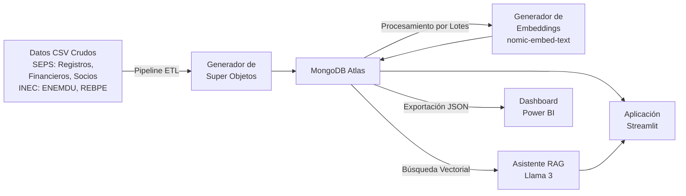

# EPS Ecuador — Plataforma de Inteligencia RAG

> Plataforma de analítica impulsada por IA para el sector de la **Economía Popular y Solidaria (EPS)** en Ecuador, combinando datos oficiales del Estado, búsqueda vectorial, LLMs locales y dashboards interactivos.

**[English](README.md)** | **Español**

[](https://python.org)
[](https://streamlit.io)
[](https://www.mongodb.com/atlas)
[](https://ollama.ai)
[](https://app.powerbi.com/view?r=eyJrIjoiNzRlYzdiNWMtYTBjYi00NTYxLWJhYWUtNzVlNzgwOWQ4YjA2IiwidCI6IjU0NDc0ZmIzLTYzNTktNDBjMS1iNzI2LTVkNTZhN2RkMjk3NiIsImMiOjR9&pageName=1203da029065d022456c)

**[Dashboard en Power BI](https://app.powerbi.com/view?r=eyJrIjoiNzRlYzdiNWMtYTBjYi00NTYxLWJhYWUtNzVlNzgwOWQ4YjA2IiwidCI6IjU0NDc0ZmIzLTYzNTktNDBjMS1iNzI2LTVkNTZhN2RkMjk3NiIsImMiOjR9&pageName=1203da029065d022456c)** · **[Informe Técnico Completo (PDF)](docs/EPS_Ecuador_Report.pdf)**

---

## Descripción General

La Economía Popular y Solidaria del Ecuador agrupa a decenas de miles de asociaciones, cooperativas y organizaciones comunitarias reguladas por la SEPS, pero sus registros están dispersos en bases separadas de datos financieros, de socios y de registro. Este proyecto unifica esas fuentes con estadísticas nacionales del INEC en una sola plataforma analítica.

El proyecto se construyó en torno a una pregunta guía:

> *¿Qué características de los socios y qué indicadores financieros hacen que una organización de la EPS sea exitosa en Ecuador?*

## ¿Qué hace la plataforma?

- **Chat con IA** — Preguntas en español con respuestas fundamentadas en datos reales de la SEPS y el INEC
- **Búsqueda Semántica** — Búsqueda de organizaciones y provincias por significado, no solo por palabras clave, mediante similitud vectorial
- **Aplicación en Streamlit** — Interfaz de chat junto a métricas y gráficos por provincia
- **Dashboard en Power BI** — Informe interactivo de seis páginas sobre geografía, sectores, inclusión financiera y pobreza
- **Pipeline ETL** — Limpieza y unificación de datos oficiales de varios años (2022-2024) en un solo documento por organización

## Cifras Clave

| Métrica | Valor |
|---------|-------|
| Organizaciones indexadas | 19.820 |
| Provincias analizadas | 24 |
| Registros procesados (REBPE) | ~890.000 |
| Dimensiones de los embeddings | 768 |
| Fecha de corte | 2024 |

## Arquitectura del Sistema



### ¿Cómo funciona el RAG?

1. **Indexación**: Cada organización y provincia tiene un resumen narrativo (`resumen_ia`) → se vectoriza en 768 dimensiones → se almacena en MongoDB Atlas con un índice de búsqueda vectorial
2. **Consulta**: La pregunta del usuario se vectoriza con el mismo modelo → `$vectorSearch` recupera las organizaciones y provincias más relevantes por similitud del coseno
3. **Generación**: Se inyectan tres fuentes de contexto en el prompt (resúmenes provinciales, estadísticas globales por sector y los resultados de la búsqueda vectorial con su puntuación de relevancia) → Llama 3 genera una respuesta fundamentada en los datos recuperados

Ejemplos de consultas que resuelve el asistente:

- *"Compara el desarrollo de la EPS entre Azuay y Guayas"*
- *"¿Qué organizaciones agropecuarias existen en zonas con alta pobreza?"*
- Consultas directas por RUC o razón social

## Aspectos Destacados de Ingeniería de Datos

- **Un documento por organización**: Los registros de 2022, 2023 y 2024 se unifican por RUC en un solo documento con una serie temporal integrada (`linea_tiempo`) de activos, utilidad y número de socios, por lo que el análisis histórico no requiere joins
- **Actualizaciones eficientes**: Los datos de socios se inyectan con escrituras por lotes (bulk write) y operadores `$set` posicionales, sin volver a subir toda la colección
- **Enriquecimiento socioeconómico**: Cada organización se vincula con el índice de pobreza de su provincia según la ENEMDU, y una colección provincial calcula el coeficiente de penetración (socios SEPS / población adulta del REBPE)
- **Calidad de datos**: Normalización de textos, mapeo de códigos del INEC a etiquetas legibles, eliminación de valores financieros imposibles (errores de digitación con cifras superiores a USD 100 millones) y preservación de los 13 dígitos del RUC y los códigos DPA, cuyos ceros a la izquierda Excel y Power BI eliminarían
- **Corrección de geolocalización**: A los nombres de provincia se les añade el sufijo ", ECUADOR" para que Azure/Bing Maps no los confunda con lugares homónimos de otros países

## Hallazgos Principales

- **La penetración es el indicador de éxito más fuerte**: Las provincias donde la EPS alcanza una mayor proporción de la población adulta muestran sectores más organizados y consolidados
- **Una base amplia de socios es clave**: Las organizaciones más exitosas se concentran en provincias de alta inclusión con un número elevado de socios
- **Socios jóvenes**: La edad promedio de los socios es de aproximadamente 31 años
- **La pobreza no tiene una relación lineal**: La EPS opera tanto en zonas de alta como de baja pobreza, pero las organizaciones más consolidadas se ubican en contextos de pobreza media
- **Predominan los sectores productivos**: Las organizaciones del sector asociativo y las actividades agropecuarias representan la mayor parte del sistema

Consulte el [informe completo](docs/EPS_Ecuador_Report.pdf) para conocer la metodología, los modelos de datos y el detalle del dashboard.

## Guía de Inicio Rápido

### Prerrequisitos

- [Python 3.10+](https://python.org)
- [Ollama](https://ollama.ai) con los modelos `llama3` y `nomic-embed-text`
- Cuenta en [MongoDB Atlas](https://www.mongodb.com/atlas) con Vector Search habilitado

### Instalación

```bash
# Clonar el repositorio
git clone https://github.com/mariosaul/eps-ecuador-rag.git
cd eps-ecuador-rag

# Crear y activar entorno virtual
python -m venv venv
source venv/bin/activate  # En Windows: venv\Scripts\activate

# Instalar dependencias
pip install -r requirements.txt

# Configurar variables de entorno
cp .env.example .env
# Edita .env con tu URI de MongoDB Atlas y demás configuraciones

# Descargar modelos en Ollama
ollama pull llama3
ollama pull nomic-embed-text
```

### Ejecutar la Aplicación

```bash
streamlit run app/dashboard.py
```

### Ejecutar el Pipeline ETL (Carga inicial)

```bash
# 1. Construir superobjetos unificados a partir de los CSVs crudos
python -m src.etl.super_object

# 2. Cargar los datos a MongoDB Atlas
python -m src.etl.data_loader

# 3. Generar embeddings (toma ~15 min para más de 10k organizaciones)
python -m src.embeddings.generator
```

## Estructura del Proyecto

```
eps-ecuador-rag/
├── app/
│   └── dashboard.py          # Interfaz web en Streamlit con Chat IA
├── docs/
│   └── EPS_Ecuador_Report.pdf  # Informe técnico completo
├── src/
│   ├── config.py             # Configuración centralizada
│   ├── database.py           # Administrador de conexiones a MongoDB
│   ├── ai/
│   │   ├── assistant.py      # Construcción de prompts RAG y llamadas al LLM
│   │   └── vector_search.py  # Búsqueda vectorial en MongoDB Atlas
│   ├── embeddings/
│   │   └── generator.py      # Generación por lotes de embeddings
│   └── etl/
│       ├── data_cleaner.py   # Limpieza y normalización de CSVs
│       ├── data_loader.py    # Carga a MongoDB y estadísticas provinciales
│       └── super_object.py   # Unificación de múltiples fuentes
├── .env.example
├── requirements.txt
├── README.md                 # Versión en inglés
└── README.es.md              # Versión en español
```

## Tecnologías Utilizadas

| Componente | Tecnología |
|------------|------------|
| **LLM** | Llama 3 (vía Ollama) |
| **Embeddings** | nomic-embed-text (768 dimensiones) |
| **Base de Datos Vectorial** | MongoDB Atlas Vector Search |
| **Backend** | Python, Pandas |
| **Frontend** | Streamlit, Plotly |
| **BI** | Power BI (DAX, Power Query, Azure Maps) |

## Fuentes de Datos

| Conjunto de Datos | Fuente | Alcance |
|-------------------|--------|---------|
| Registro de Organizaciones | SEPS | 2022-2024, ~19.800 organizaciones |
| Estados Financieros | SEPS | Activos, pasivos, patrimonio, utilidad |
| Información de Socios | SEPS | Sexo, rango de edad, instrucción, antigüedad |
| Empleo y Pobreza | ENEMDU 2024 (INEC) | Indicadores provinciales de pobreza y empleo |
| Registro de Empresas y Población | REBPE (INEC) | ~890.000 registros, población adulta por provincia |

## Equipo

- **Saúl Casanova** — Líder del proyecto. Arquitectura, pipeline ETL, modelo de datos en MongoDB, embeddings, asistente RAG y aplicación en Streamlit
- **Mateo Pastrano, Mateo Benites, Sebastian Terán** — Diseño y desarrollo del dashboard en Power BI

## Licencia

Distribuido bajo la licencia [MIT](LICENSE). © Mario Saul
