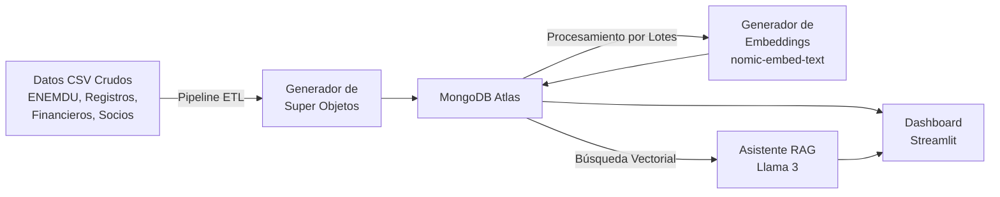

# EPS Ecuador — Plataforma de Inteligencia RAG

> Plataforma de análisis impulsada por IA para el sector de la **Economía Popular y Solidaria (EPS)** en Ecuador, combinando búsqueda vectorial semántica, LLMs locales y dashboards interactivos.

**[English](README.md)** | **Español**

[](https://python.org)
[](https://streamlit.io)
[](https://www.mongodb.com/atlas)
[](https://ollama.ai)

> [!NOTE]
> **Proyecto de Portafolio**: Este repositorio contiene la arquitectura de software, el pipeline de datos (ETL) y el código fuente desarrollados para una tesis de ingeniería. Para ejecutarlo localmente, configure un clúster de MongoDB Atlas con Vector Search y una instancia local de Ollama según la [Guía de Inicio](#guía-de-inicio-rápido).

---

## ¿Qué hace la plataforma?

Esta plataforma permite a investigadores, analistas y tomadores de decisiones **hacer preguntas en lenguaje natural** sobre el sector de la economía social y solidaria del Ecuador, obteniendo respuestas fundamentadas en datos oficiales mediante RAG (*Retrieval-Augmented Generation*):

- **Chat con IA** — Consultas técnicas en español con respuestas respaldadas por datos reales.
- **Búsqueda Semántica** — Búsqueda de organizaciones por similitud vectorial (significado y contexto, no solo palabras clave).
- **Dashboard Interactivo** — Métricas territoriales por provincia, desglose por sectores e integración con Power BI.
- **Pipeline ETL** — Procesamiento y unificación de 3 años de datos oficiales (2022-2024) de múltiples fuentes del Estado.

## Arquitectura del Sistema



### ¿Cómo funciona el RAG?

1. **Indexación**: Cada organización genera un resumen textual → se vectoriza en un espacio de 768 dimensiones → se indexa en MongoDB Atlas Vector Search.
2. **Consulta**: La pregunta del usuario se vectoriza con el mismo modelo → la búsqueda por similitud vectorial recupera las $K$ organizaciones más relevantes.
3. **Generación**: La información recuperada junto con las estadísticas provinciales se inyectan como contexto estructurado en Llama 3, generando una respuesta técnica libre de alucinaciones.

## Guía de Inicio Rápido

### Prerrequisitos

- [Python 3.10+](https://python.org)
- [Ollama](https://ollama.ai) con los modelos `llama3` y `nomic-embed-text`
- Cuenta en [MongoDB Atlas](https://www.mongodb.com/atlas) con Vector Search habilitado

### Instalación

```bash
# Clonar el repositorio
git clone https://github.com/mariosaul/eps-ecuador-rag.git
cd eps-ecuador-rag

# Crear y activar entorno virtual
python -m venv venv
source venv/bin/activate  # En Windows: venv\Scripts\activate

# Instalar dependencias
pip install -r requirements.txt

# Configurar variables de entorno
cp .env.example .env
# Edita .env con tu URI de conexión a MongoDB Atlas

# Descargar modelos en Ollama
ollama pull llama3
ollama pull nomic-embed-text
```

### Ejecutar la Aplicación

```bash
streamlit run app/dashboard.py
```

### Ejecutar el Pipeline ETL (Carga inicial)

```bash
# 1. Construir superobjetos unificados a partir de los CSVs crudos
python -m src.etl.super_object

# 2. Cargar los datos maestros a MongoDB Atlas
python -m src.etl.data_loader

# 3. Generar embeddings vectoriales (procesamiento en lotes)
python -m src.embeddings.generator
```

## Estructura del Proyecto

```
eps-ecuador-rag/
├── app/
│   └── dashboard.py          # Interfaz web en Streamlit con Chat IA
├── src/
│   ├── config.py             # Configuración centralizada de entorno
│   ├── database.py           # Administrador de conexiones a MongoDB
│   ├── ai/
│   │   ├── assistant.py      # Lógica de prompts RAG e inferencia LLM
│   │   └── vector_search.py  # Búsqueda vectorial en MongoDB Atlas
│   ├── embeddings/
│   │   └── generator.py      # Generación por lotes de embeddings
│   └── etl/
│       ├── data_cleaner.py   # Limpieza y normalización de CSVs
│       ├── data_loader.py    # Carga a MongoDB y métricas provinciales
│       └── super_object.py   # Consolidación de fuentes multinivel
├── .env.example
├── requirements.txt
├── README.md                 # Versión en Inglés
└── README.es.md              # Versión en Español
```

## Tecnologías Utilizadas

| Componente | Tecnología |
|------------|------------|
| **LLM** | Llama 3 (vía Ollama) |
| **Embeddings** | nomic-embed-text (768 dimensiones) |
| **Base de Datos Vectorial** | MongoDB Atlas Vector Search |
| **Procesamiento de Datos** | Python, Pandas, NumPy |
| **Frontend Interactivo** | Streamlit, Plotly |
| **Inteligencia de Negocios** | Power BI Embedded |

## Fuentes de Datos Oficiales

| Conjunto de Datos | Fuente Institucional | Volumen Aprox. |
|-------------------|----------------------|----------------|
| Registro de Organizaciones | SEPS (2022-2024) | ~10.000+/año |
| Balances Financieros | SEPS Balances | ~10.000+/año |
| Nómina de Socios | SEPS | ~10.000+/año |
| Indicadores de Pobreza | ENEMDU 2024 (INEC) | ~17M registros de encuesta |
| Población Adulta Territorial | REBPE 2023 (INEC) | ~17M registros censales |

## Licencia

Distribuido bajo la licencia [MIT](LICENSE). © Mario Saul
