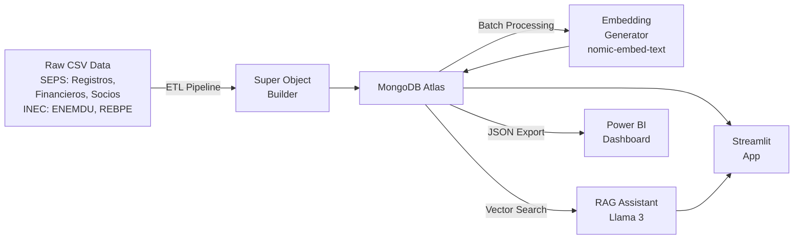

# EPS Ecuador — RAG Intelligence Platform

> AI-powered analytics platform for Ecuador's **Economía Popular y Solidaria** (Social & Solidarity Economy) sector, combining official government data, vector search, local LLMs, and interactive dashboards.

**English** | **[Español](README.es.md)**

[](https://python.org)
[](https://streamlit.io)
[](https://www.mongodb.com/atlas)
[](https://ollama.ai)
[](https://app.powerbi.com/view?r=eyJrIjoiNzRlYzdiNWMtYTBjYi00NTYxLWJhYWUtNzVlNzgwOWQ4YjA2IiwidCI6IjU0NDc0ZmIzLTYzNTktNDBjMS1iNzI2LTVkNTZhN2RkMjk3NiIsImMiOjR9&pageName=1203da029065d022456c)

**[Live Power BI Dashboard](https://app.powerbi.com/view?r=eyJrIjoiNzRlYzdiNWMtYTBjYi00NTYxLWJhYWUtNzVlNzgwOWQ4YjA2IiwidCI6IjU0NDc0ZmIzLTYzNTktNDBjMS1iNzI2LTVkNTZhN2RkMjk3NiIsImMiOjR9&pageName=1203da029065d022456c)** · **[Full Technical Report (PDF, Spanish)](docs/EPS_Ecuador_Report.pdf)**

---

## Overview

Ecuador's Social & Solidarity Economy includes tens of thousands of associations, cooperatives, and community organizations regulated by the SEPS, but their records are scattered across separate financial, membership, and registry datasets. This project unifies those sources with national statistics from INEC into a single analytical platform.

It was built around one guiding question:

> *What member characteristics and financial indicators make an EPS organization successful in Ecuador?*

## What It Does

- **AI Chat** — Ask questions in Spanish and get answers grounded in real SEPS and INEC data
- **Semantic Search** — Find organizations and provinces by meaning, not just keywords, using vector similarity
- **Streamlit App** — Chat interface alongside province-level metrics and charts
- **Power BI Dashboard** — Six-page interactive report covering geography, sectors, financial inclusion, and poverty
- **ETL Pipeline** — Cleans and merges multi-year government data (2022-2024) into one document per organization

## Key Numbers

| Metric | Value |
|--------|-------|
| Organizations indexed | 19,820 |
| Provinces analyzed | 24 |
| Registry records processed (REBPE) | ~890,000 |
| Embedding dimensions | 768 |
| Data cutoff | 2024 |

## Architecture



### How the RAG Works

1. **Index**: Each organization and province gets a narrative summary (`resumen_ia`) → embedded into a 768-dim vector → stored in MongoDB Atlas with a vector search index
2. **Query**: User question → embedded with the same model → `$vectorSearch` retrieves the most relevant organizations and provinces by cosine similarity
3. **Generate**: Three context sources are injected into the prompt (province summaries, global sector statistics, and the top vector search hits with relevance scores) → Llama 3 generates an answer grounded in the retrieved data

Example questions the assistant handles:

- *"Compara el desarrollo de la EPS entre Azuay y Guayas"*
- *"¿Qué organizaciones agropecuarias existen en zonas con alta pobreza?"*
- Direct lookups by RUC or organization name

## Data Engineering Highlights

- **One document per organization**: Records from 2022, 2023, and 2024 are merged by RUC into a single document with an embedded time series (`linea_tiempo`) of assets, profit, and member counts, so historical analysis needs no joins
- **Efficient updates**: Member data is injected with MongoDB bulk writes and positional `$set` operators instead of re-uploading the whole collection
- **Socioeconomic enrichment**: Each organization is linked to its province's poverty index from ENEMDU, and a provincial collection computes a penetration coefficient (SEPS members / adult population from REBPE)
- **Data quality**: Text normalization, INEC code-to-label mapping, removal of impossible financial values (typos producing figures over USD 100M), and preservation of 13-digit RUCs and DPA codes whose leading zeros Excel and Power BI would otherwise strip
- **Geocoding fix**: Province names are suffixed with ", ECUADOR" so Azure/Bing Maps doesn't confuse them with same-named places in other countries

## Key Findings

- **Penetration is the strongest success signal**: Provinces where the EPS reaches a larger share of the adult population show more organized and consolidated sectors
- **A broad member base matters**: The most successful organizations concentrate in high-inclusion provinces with large memberships
- **Young membership**: The average member age is roughly 31 years
- **Poverty is not linear**: The EPS operates in both high- and low-poverty areas, but the most consolidated organizations cluster in medium-poverty contexts
- **Productive sectors dominate**: Associative organizations and agricultural activities account for the largest share of the system

See the [full report](docs/EPS_Ecuador_Report.pdf) for methodology, data models, and dashboard details.

## Quick Start

### Prerequisites

- [Python 3.10+](https://python.org)
- [Ollama](https://ollama.ai) with `llama3` and `nomic-embed-text` models
- [MongoDB Atlas](https://www.mongodb.com/atlas) account with Vector Search enabled

### Setup

```bash
# Clone the repo
git clone https://github.com/mariosaul/eps-ecuador-rag.git
cd eps-ecuador-rag

# Create virtual environment
python -m venv venv
source venv/bin/activate  # Windows: venv\Scripts\activate

# Install dependencies
pip install -r requirements.txt

# Configure environment
cp .env.example .env
# Edit .env with your MongoDB URI and other settings

# Pull Ollama models
ollama pull llama3
ollama pull nomic-embed-text
```

### Run the App

```bash
streamlit run app/dashboard.py
```

### Run the ETL Pipeline (first time setup)

```bash
# 1. Build unified organization objects from raw CSVs
python -m src.etl.super_object

# 2. Upload to MongoDB Atlas
python -m src.etl.data_loader

# 3. Generate embeddings (takes ~15 min for 10k+ orgs)
python -m src.embeddings.generator
```

## Project Structure

```
eps-ecuador-rag/
├── app/
│   └── dashboard.py          # Streamlit UI with AI chat
├── docs/
│   └── EPS_Ecuador_Report.pdf  # Full technical report (Spanish)
├── src/
│   ├── config.py             # Centralized configuration
│   ├── database.py           # MongoDB connection manager
│   ├── ai/
│   │   ├── assistant.py      # RAG prompt building & LLM calls
│   │   └── vector_search.py  # MongoDB Atlas Vector Search
│   ├── embeddings/
│   │   └── generator.py      # Batch embedding generation
│   └── etl/
│       ├── data_cleaner.py   # CSV preprocessing utilities
│       ├── data_loader.py    # MongoDB upload & province stats
│       └── super_object.py   # Multi-source data merger
├── .env.example
├── requirements.txt
├── README.md                 # English version
└── README.es.md              # Spanish version
```

## Tech Stack

| Component | Technology |
|-----------|-----------|
| **LLM** | Llama 3 (via Ollama) |
| **Embeddings** | nomic-embed-text (768 dimensions) |
| **Vector Database** | MongoDB Atlas Vector Search |
| **Backend** | Python, Pandas |
| **Frontend** | Streamlit, Plotly |
| **BI** | Power BI (DAX, Power Query, Azure Maps) |

## Data Sources

| Dataset | Source | Scope |
|---------|--------|-------|
| Organization Registry | SEPS | 2022-2024, ~19,800 organizations |
| Financial Statements | SEPS | Assets, liabilities, equity, profit |
| Member (Socios) Data | SEPS | Sex, age range, education, seniority |
| Employment & Poverty | ENEMDU 2024 (INEC) | Provincial poverty and labor indicators |
| Business & Population Registry | REBPE (INEC) | ~890,000 records, adult population by province |

## Team

- **Mario Saúl Casanova** — Project lead. Architecture, ETL pipeline, MongoDB data model, embeddings, RAG assistant, and Streamlit app
- **Mateo Pastrano, Mateo Benites, Sebastian Terán** — Power BI dashboard design and development

## License

[MIT](LICENSE) © Mario Saul
