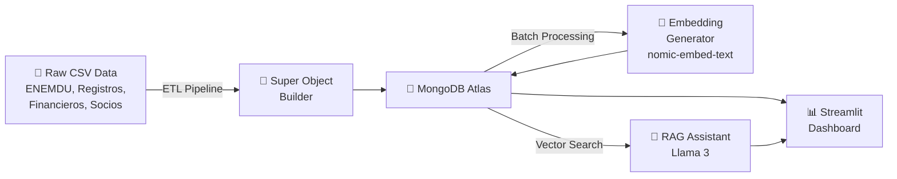

# 🇪🇨 EPS Ecuador — RAG Intelligence Platform

> AI-powered analysis platform for Ecuador's **Economía Popular y Solidaria** (Social & Solidarity Economy) sector, combining vector search, local LLMs, and interactive dashboards.

🌐 **English** | **[Español](README.es.md)**

> [!NOTE]
> **Academic Thesis & Portfolio Showcase**: This repository contains the architecture, data pipeline, and codebase developed for a graduate/engineering thesis. To run this project locally, configure your own MongoDB Atlas Vector Search cluster and local Ollama instance following the [Quick Start](#-quick-start) guide.

[](https://python.org)
[](https://streamlit.io)
[](https://www.mongodb.com/atlas)
[](https://ollama.ai)

---

## 🎯 What It Does

This platform lets researchers and policymakers **ask natural language questions** about Ecuador's social economy sector and get data-driven answers powered by RAG (Retrieval-Augmented Generation):

- 💬 **AI Chat** — Ask questions in Spanish, get analysis backed by real data
- 🔍 **Semantic Search** — Find relevant organizations using vector similarity (not just keywords)
- 📊 **Interactive Dashboard** — Province-level metrics, sector breakdowns, and Power BI integration
- 🧬 **ETL Pipeline** — Processes 3 years of government data (2022-2024) from multiple sources

## 🏗️ Architecture



### How the RAG Works

1. **Index**: Each organization gets a text summary → embedded into a 768-dim vector → stored in MongoDB Atlas
2. **Query**: User question → embedded with the same model → vector similarity search finds top-K relevant orgs
3. **Generate**: Retrieved documents + province statistics → injected as context → Llama 3 generates a grounded answer

## 🚀 Quick Start

### Prerequisites

- [Python 3.10+](https://python.org)
- [Ollama](https://ollama.ai) with `llama3` and `nomic-embed-text` models
- [MongoDB Atlas](https://www.mongodb.com/atlas) account with Vector Search enabled

### Setup

```bash
# Clone the repo
git clone https://github.com/mariosaul/eps-ecuador-rag.git
cd eps-ecuador-rag

# Create virtual environment
python -m venv venv
source venv/bin/activate  # Windows: venv\Scripts\activate

# Install dependencies
pip install -r requirements.txt

# Configure environment
cp .env.example .env
# Edit .env with your MongoDB URI and other settings

# Pull Ollama models
ollama pull llama3
ollama pull nomic-embed-text
```

### Run the Dashboard

```bash
streamlit run app/dashboard.py
```

### Run the ETL Pipeline (first time setup)

```bash
# 1. Build unified organization objects from raw CSVs
python -m src.etl.super_object

# 2. Upload to MongoDB Atlas
python -m src.etl.data_loader

# 3. Generate embeddings (takes ~15 min for 10k+ orgs)
python -m src.embeddings.generator
```

## 📁 Project Structure

```
eps-ecuador-rag/
├── app/
│   └── dashboard.py          # Streamlit UI with AI chat
├── src/
│   ├── config.py             # Centralized configuration
│   ├── database.py           # MongoDB connection manager
│   ├── ai/
│   │   ├── assistant.py      # RAG prompt building & LLM calls
│   │   └── vector_search.py  # MongoDB Atlas Vector Search
│   ├── embeddings/
│   │   └── generator.py      # Batch embedding generation
│   └── etl/
│       ├── data_cleaner.py   # CSV preprocessing utilities
│       ├── data_loader.py    # MongoDB upload & province stats
│       └── super_object.py   # Multi-source data merger
├── .env.example
├── requirements.txt
└── README.md
```

## 🛠️ Tech Stack

| Component | Technology |
|-----------|-----------|
| **LLM** | Llama 3 (via Ollama) |
| **Embeddings** | nomic-embed-text (768 dimensions) |
| **Vector Database** | MongoDB Atlas Vector Search |
| **Backend** | Python, Pandas |
| **Frontend** | Streamlit, Plotly |
| **BI Integration** | Power BI Embedded |

## 📊 Data Sources

| Dataset | Source | Records |
|---------|--------|---------|
| Organization Registry | SEPS (2022-2024) | ~10,000+/year |
| Financial Data | SEPS Balance Sheets | ~10,000+/year |
| Member (Socios) Data | SEPS | ~10,000+/year |
| Poverty Indicators | ENEMDU 2024 (INEC) | ~17M survey records |
| Adult Population | REBPE 2023 (INEC) | ~17M census records |

## 📝 License

[MIT](LICENSE) © Mario Saul
